# Домашняя работа 3. Cassandra

Сервис, который записывает действия пользователя (вход, покупка, просмотр) в таблицу `user_actions` и показывает ленту последних событий.

Что где лежит:
- `solution.py`: моё решение (заполнила все TODO, остальные файлы комплекта не меняла);
- `results/`: результаты прогонов;
- `screenshots/`: скриншоты по каждому пункту, подписи в конце README.

Все сценарии прошли: в `lab all` 30 проверок, в `metrics` ещё 10.

## Как запустить

Важно! У меня вместо Docker стоит Podman так как корп ноут, поэтому команды начинаются с `podman compose`. Скрипт `ops.sh` внутри вызывает `docker compose`, так что я сделала маленькую обёртку: команда `docker` просто передаёт всё в `podman`.

```sh
podman machine start
mkdir -p /tmp/docker-shim
printf '#!/bin/sh\nexec podman "$@"\n' > /tmp/docker-shim/docker
chmod +x /tmp/docker-shim/docker
export PATH=/tmp/docker-shim:$PATH
export PODMAN_COMPOSE_WARNING_LOGS=false

podman compose up -d
podman compose exec -T c1 nodetool status
podman compose run --rm lab reset
podman compose run --rm lab data
podman compose run --rm lab compaction
podman compose exec -T c1 cqlsh -e "CONSISTENCY ALL; TRACING ON; SELECT * FROM hw3.user_actions WHERE user_id = 3001;" | tee results/tracing.txt | grep -E 'rows\)|tombstone cells'
podman compose run --rm lab bulk
bash ops.sh tablestats
bash ops.sh compact
podman compose run --rm lab consistency
bash ops.sh repair
podman compose run --rm lab metrics
podman compose run --rm lab all
podman compose down
```

На что я наткнулась:
- **Важно учиывать порядок команд.** Каждый сценарий пересоздаёт keyspace `hw3` с нуля. Поэтому трассировку надо снимать сразу после `compaction` (пока в базе есть истёкшие строки), а `tablestats` сразу после `bulk` (пока в таблицах по 10 000 событий).
- **После поднятия нужно чуть подождать**, пока `nodetool status` покажет три узла со статусом `UN` (узел работает). Узлы находят друг друга не сразу. Один раз я запустила `lab all` слишком рано и получила ошибку `table user_actions does not exist`, а через минуту всё прошло.
- **Числа в таблицах ниже взяты из `lab all`**, он шёл последним и записал их в `results/results.json` (скриншот 10). Числа отдельных запусков (скриншоты 4 и 7) немного другие, я их тоже указываю.

Весь стенд работал у меня на ноутбуке: виртуалка Podman на 2 процессора и 4 ГБ, каждый узел занимал около 0,8 ГБ.

## Раздел 2. Таблица и модель данных

```sql
CREATE TABLE IF NOT EXISTS user_actions (
  user_id int,
  event_time timestamp,
  event_type text,
  payload text,
  PRIMARY KEY (user_id, event_time)
) WITH CLUSTERING ORDER BY (event_time DESC)
  AND compression = {'class': 'LZ4Compressor'};
```

Вторая таблица `user_actions_none` такая же, только без сжатия: `compression = {'enabled': 'false'}`.

Сценарий `data` проверил, что схема правильная, и прочитал 5 последних событий из 20 тестовых. Они пришли в нужном порядке, от 19-го к 15-му.

**Почему партиция по `user_id`.** Как я поняла из лекции, Cassandra берёт partition key, считает от него хеш (токен) и по токену решает, на каком узле хранить данные. Все строки с одинаковым partition key лежат вместе, это и есть партиция. У нас ключ `user_id`, значит все события одного пользователя лежат в одном месте. Лента нужна как раз для одного пользователя, поэтому она читается одним запросом в одно место. А разные пользователи распределяются по узлам.

Минус: у очень активного пользователя партиция может стать огромной. На лекции советовали в таком случае сразу добавлять в partition key что-то вроде дня. Потом это сделать уже нельзя, ключ таблицы через `ALTER` не меняется.

**Зачем `DESC`.** Clustering key задаёт, в каком порядке строки лежат внутри партиции, причём прямо на диске. С `DESC` новые события лежат первыми. Лента берёт их с начала, ничего не сортируя, а `LIMIT` останавливает чтение, как только набрал нужное число строк. Порядок сортировки тоже потом не поменять, только пересоздать таблицу.

**Что будет при двух событиях с одинаковым `event_time`.** Ключ `(user_id, event_time)` означает, что пара «пользователь и время» определяет одну строку. Но Cassandra не проверяет, есть ли уже такая строка. Второй `INSERT` с тем же ключом просто перезапишет первый, и никакой ошибки не будет. Для меня это было неожиданно: в обычных базах был бы конфликт ключа.

Для журнала аудита это плохо: событие пропадёт, и никто не заметит. На лекции сказали, что за уникальность в Cassandra отвечает само приложение. Значит, ключ должен быть уникальным для каждого события. Я бы добавила в ключ идентификатор события, который генерирует приложение: `PRIMARY KEY (user_id, event_time, event_id)`. Сортировка по времени при этом сохранится. Поменять ключ у готовой таблицы нельзя, поэтому пришлось бы делать миграцию, как на лекции: создать новую таблицу, писать в обе, перенести старые данные, сверить и переключить чтение.

## Раздел 3. Вставка и чтение

```sql
INSERT INTO user_actions (user_id, event_time, event_type, payload) VALUES (?, ?, ?, ?)
SELECT user_id, event_time, event_type, payload FROM user_actions WHERE user_id = ? LIMIT ?
```

| Что вставлено | Сколько | Время |
|---|---|---|
| События пользователя 1001 (`login`, `purchase`, `view`) | 10 000 | 5,780 с (примерно 0,58 мс на запись) |

Записи шли по одной на уровне ONE. Сценарий проверил, что в партиции ровно 10 000 строк и что последние события идут от новых к старым. Отдельный запуск `bulk` дал 6,728 с (скриншот 4): всё крутится на одной виртуалке, поэтому время немного скачет.

**Что даёт PreparedStatement.** В коде запрос с `?` подготавливается один раз через `session.prepare`, а потом на каждое из 10 000 событий я только подставляю значения через `bind`. То есть запрос не собирается заново из строк каждый раз, а значения передаются отдельно от текста запроса. Уровень консистентности я тоже задаю на подготовленном запросе: на лекции говорили, что уровень выбирается под конкретную операцию. И ещё из лекции: перед выполнением подготовленных запросов драйвер проверяет версию схемы.

## Раздел 4. Консистентность

Сценарий делал 1000 записей и читал 20 последних событий. Каждый замер повторялся 6 раз: первый раз для разогрева, в таблице медиана остальных пяти.

| Уровень | Запись, мс (1000 записей) | Чтение, мс (20 событий) |
|---|---|---|
| ONE | 553 | 2 |
| QUORUM | 683 | 3 |

Все замеры есть в `results/results.json`: запись ONE от 490 до 666 мс, QUORUM от 617 до 903 мс, чтение от 2 до 3 мс. В этом прогоне QUORUM медленнее, а в отдельном запуске (скриншот 7) он был даже чуть быстрее: 689 против 705 мс. Сначала меня это удивило, но на лекции как раз говорили, что на трёх узлах на одной машине разница теряется в погрешности. Реальная разница между уровнями видна, когда узлы падают.

**Формула W + R > N**, как я её поняла:
- N: сколько копий у каждой записи. У нас 3.
- W: сколько копий должны подтвердить запись.
- R: сколько копий опрашивается при чтении.

Если W + R > N, то хотя бы одна копия, которую опросили при чтении, точно получила свежую запись. Поэтому чтение увидит последнее значение.

- **ONE:** запись ждёт одного подтверждения, чтение спрашивает одну копию. 1 + 1 = 2, это меньше 3, так что можно прочитать старое значение. И если единственная копия, которая подтвердила запись, сломается раньше, чем запись дойдёт до остальных, запись потеряется.
- **QUORUM:** большинство, то есть 2 из 3. 2 + 2 = 4 > 3, формула выполняется. При чтении сравниваются ответы двух копий, берётся более свежий, а отставшую копию сразу поправляют (это read repair).
- **Что даёт QUORUM:** видна последняя запись, и всё работает, даже если один узел из трёх упал. Если упадут два, QUORUM вернёт ошибку, а не будет тихо работать с одной копией.
- Запись всё равно отправляется на все три копии. Уровень определяет только, сколько ответов ждать.

На лекции разбирали ловушку: запись ONE плюс чтение QUORUM дают 1 + 2 = 3, а нужно больше 3.

**Что я бы выбрала для ленты.** Пользователь должен видеть в ленте свои же действия, поэтому чтение QUORUM, как на лекции. Запись на лекции делали на ONE, потому что это быстрее. Но тогда получается та самая ловушка: пользователь может не увидеть только что сделанную покупку. Для журнала аудита мне это кажется неприемлемым, поэтому я бы подняла запись до QUORUM (этот вариант на лекции тоже упоминали). По моим замерам это стоит около 130 мс на 1000 записей, примерно 0,13 мс на одну запись. Мне кажется, это нормальная цена за то, что событие не потеряется.

## Раздел 5. Сжатие

Обе таблицы заполнены одинаково, по 10 000 событий. Перед статистикой `ops.sh` делает `nodetool flush`, чтобы данные из памяти записались на диск.

| Таблица | Space used (total) | SSTable count | SSTable Compression Ratio |
|---|---|---|---|
| `user_actions` (LZ4) | 151 963 байт (148,4 КиБ) | 1 | 0,38162 |
| `user_actions_none` (без сжатия) | 387 276 байт (378,2 КиБ) | 1 | -1,00000 (сжатие выключено) |

`Compression Ratio` показывает, сколько осталось от исходного размера. У нас 0,38, то есть таблица со сжатием примерно в 2,6 раза меньше. -1 значит, что сжатия нет.

**Чем платим за сжатие.** Cassandra сжимает файл на диске не целиком, а кусками (блоками по 16 КБ по умолчанию).
- **При записи** тратится процессор. На лекции показывали: при записи миллиона строк LZ4 добавил несколько процентов времени, ZSTD десятки процентов.
- **При чтении** надо распаковать весь блок, где лежит нужная строка. Для ленты это не страшно, она читает много строк подряд. А чтобы достать одну строку, распаковывается весь блок.
- **Что получаем:** меньше места на диске и меньше данных по сети. Что важнее, диск или процессор, зависит от нагрузки.

**Почему здесь сжатие выгодно.** В событиях много повторов: одинаковые названия полей в `payload`, всего три типа событий, похожие даты. Повторы хорошо сжимаются. На лекции для такого журнала называли сжатие от 3 до 5 раз, у нас вышло 2,6 раза, потому что тестовый `payload` совсем короткий (`{"seq": i}`). LZ4 лёгкий для процессора и быстро распаковывается, для журнала, куда постоянно пишут и откуда читают, это подходит.

## Раздел 6. Bloom-фильтр

| Показатель | Значение |
|---|---|
| Bloom filter false positives | 0 |
| Bloom filter false ratio | 0,00000 |

Источник: `results/tablestats.txt`, таблица `hw3.user_actions`.

**Что это такое.** Данные на диске лежат в нескольких файлах (SSTable), и у каждого файла есть свой Bloom-фильтр. Это компактная структура в памяти, которая на вопрос «есть ли в этом файле такая партиция?» отвечает «точно нет» или «возможно, есть». Если ответ «точно нет», файл даже не открывают. Ошибаться фильтр может только в одну сторону: иногда говорит «возможно, есть», когда партиции нет. А пропустить существующую партицию он не может.

**Что значит метрика.** False positive это как раз случай, когда фильтр сказал «возможно, есть», а партиции в файле не оказалось. Ничего не ломается, просто файл проверили зря. `false positives` это сколько раз так было, `false ratio` это доля таких ошибок. Допустимую долю задаёт настройка таблицы `bloom_filter_fp_chance`, по умолчанию 0,01 (около 1%). Нормально, когда false ratio близок к нулю.

У нас 0, потому что файл один, партиция одна, и мы читали только существующего пользователя.

**Когда фильтр полезен.** Когда файлов много: фильтр сразу отсекает те, где нужной партиции нет. На лекции был пример, где партиция лежала в 2 файлах из 10, и фильтр сразу отбросил остальные 8. Когда файл один и нужные данные в нём есть, фильтру нечего отсекать, как у нас.

## Раздел 7. Repair

`bash ops.sh repair` запустил `nodetool repair hw3`, вывод в `results/repair.txt`:

```
Starting repair command #1 ..., repairing keyspace hw3 with repair options (parallelism: parallel, primary range: false, incremental: true, ..., # of ranges: 48, ...)
Repair completed successfully
Repair command #1 finished in 1 second
```

Проверено 48 диапазонов, как в примере с лекции. Всё прошло за секунду: копии и так совпадали, чинить было нечего. На лекции говорили, что на здоровом кластере repair это проверка, а не лечение.

**Что такое anti-entropy и зачем `nodetool repair`.** Это плановая сверка копий между узлами. Сравнивать все данные напрямую слишком дорого, поэтому каждый узел считает хеши своих данных и собирает их в дерево (дерево Меркла). Узлы сравнивают деревья сверху вниз и пересылают друг другу только те куски, где хеши не совпали.

**Когда нужен repair:**
- регулярно, и чаще чем раз в `gc_grace_seconds` (по умолчанию 10 дней);
- если узел лежал дольше 3 часов (дольше этого хинты не копятся, про них ниже);
- после массовых удалений;
- перед изменениями конфигурации кластера.

**Что будет, если его не запускать:**
- копии разъезжаются, и чтение на ONE иногда возвращает старые данные без всякой ошибки;
- отметки об удалении (tombstones) доходят не до всех копий;
- удалённые данные могут «воскреснуть», если узел со старой копией вернётся, когда на других узлах отметки об удалении уже стёрты.

**Чем отличается от других механизмов:**
- **Hinted handoff:** если узел недоступен, другой узел сохраняет для него запись («передать c3») и отдаёт, когда тот вернётся. Работает только для коротких простоев, до 3 часов, и без гарантий.
- **Read repair:** при чтении сравниваются ответы копий и отставшая поправляется. Но только для того ключа, который прочитали. Старые события, которые никто не читает, так и останутся разными.
- **`nodetool repair`** проверяет вообще все данные, включая то, что не поймали первые два механизма.

## Раздел 8. TTL и компакция

```sql
ALTER TABLE user_actions WITH compaction = {
  'class': 'TimeWindowCompactionStrategy',
  'compaction_window_unit': 'DAYS',
  'compaction_window_size': 1
} AND default_time_to_live = 2592000;
```

| Показатель | Значение |
|---|---|
| Стратегия компакции | `TimeWindowCompactionStrategy`, окно 1 день (`compaction_window_unit: DAYS`, `compaction_window_size: 1`) |
| default_time_to_live | 2592000 с (30 дней) |
| События с TTL 5 секунд: до / после истечения | 5 / 0 |

Источник: `results/results.json`, раздел `artifacts.compaction`. Сценарий записал 5 строк для пользователя 3001 с `USING TTL 5`: сразу их видно 5, а после истечения ни одной.

**Трассировка чтения** этой партиции (`results/tracing.txt`, `CONSISTENCY ALL`, чтобы спросить все три узла):

```
(0 rows)
Read 0 live rows and 10 tombstone cells [ReadStage-1] | ... | 10.89.2.3
Read 0 live rows and 10 tombstone cells [ReadStage-1] | ... | 10.89.2.4
Read 0 live rows and 10 tombstone cells [ReadStage-2] | ... | 10.89.2.2
```

Здесь хорошо видно то, о чём говорили на лекции: строк в ответе 0, но каждый узел всё равно прочитал 10 отметок об удалении (5 строк по 2 колонки). То есть строка с истёкшим TTL не исчезает сразу, а превращается в tombstone и какое-то время продолжает лежать на диске.

**Компакция** (`bash ops.sh compact`, `results/compaction.txt`):

```
keyspace_name columnfamily_name compacted_at            bytes_in bytes_out rows_merged compaction_properties
hw3           user_actions      2026-11-07T21:08:26.057 146401   146401    {1:1}       {compaction_type:Major compaction}
```

На входе был один файл, на выходе такой же по размеру. Объединять было нечего: все 10 000 событий и так лежали в одном файле, ничего не удалялось.

**Почему для журнала TWCS лучше STCS.**
- **TWCS** раскладывает данные по окнам времени (у нас по дням) и объединяет файлы только внутри одного окна. Событие записали, и больше его не меняют. Окно за прошлый день один раз объединяется и дальше не трогается. Лента читает только свежее окно. А когда у всего окна истёк TTL и прошло `gc_grace_seconds`, место освобождается целыми файлами.
- **STCS** (стратегия по умолчанию) объединяет файлы похожего размера, не глядя на время. Для журнала это значит, что старые события постоянно перемешиваются с новыми и перезаписываются, хотя их никто не читает. А пока файлов много, чтению приходится проверять каждый.

**TTL и `gc_grace_seconds`.** Как я поняла: строка с истёкшим TTL становится отметкой об удалении, и эта отметка хранится ещё `gc_grace_seconds` (по умолчанию 10 дней). Это нужно на случай, если какой-то узел был недоступен: когда он вернётся, отметка должна до него дойти, иначе старая строка «воскреснет». Поэтому место на диске освобождается не сразу после TTL, а позже. На лекции предупреждали, что уменьшать `gc_grace_seconds` можно, только если чаще запускать repair.

**Почему TTL лучше массового DELETE.**
- Удаляется столько же, но равномерно. Пример с лекции: если каждый день истекает около 300 строк, это спокойный фоновый поток. А ручная чистка раз в месяц это 9000 DELETE разом, с пиком нагрузки.
- Каждый `DELETE` это тоже запись: он создаёт отметку об удалении, и чтение потом через неё проходит. При 1000 таких отметок в одном запросе в логе появляется предупреждение, а примерно при 100 000 запрос падает.
- Истечение TTL не надо рассылать по узлам: срок хранится вместе со строкой, и каждый узел сам понимает, что она истекла.
- Но TTL подходит, только если срок жизни известен заранее. Если удалить надо прямо сейчас, нужен обычный DELETE.

## Результаты

Всё лежит в `results/`:
- `results.json`: статусы и числа всех сценариев (`data`, `compaction`, `bulk`, `consistency`, `metrics`: passed);
- `tablestats.txt`, `tablestats_plain.txt`: вывод `bash ops.sh tablestats`;
- `repair.txt`: вывод `bash ops.sh repair`;
- `compaction.txt`: вывод `bash ops.sh compact`;
- `tracing.txt`: трассировка чтения партиции с истёкшими строками;
- `README.md`: заготовки таблиц из комплекта задания.

## Скриншоты

Скриншоты сделаны за один прогон.

**1. Стенд.** Три узла в статусе `UN`

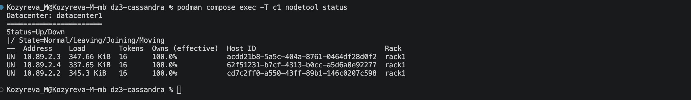

**2. Раздел 2.** Код `create_tables` и сценарий `data`

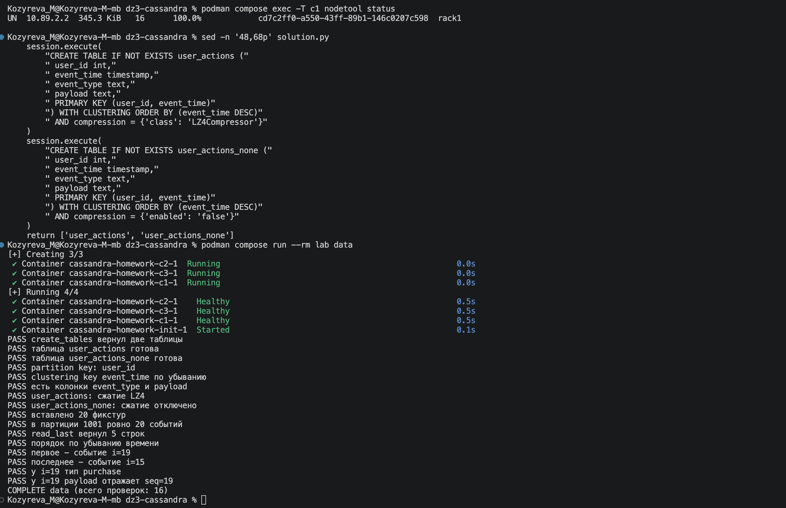

**3. Раздел 8, TTL.** Код `configure_twcs_ttl`, сценарий `compaction`

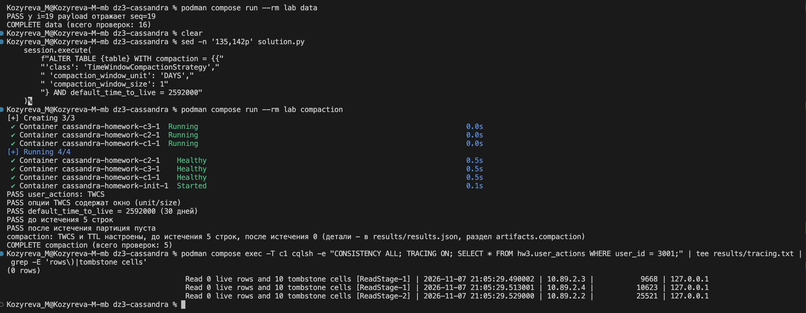

**4. Раздел 3.** Запросы `insert_events` и `read_last`, сценарий `bulk`

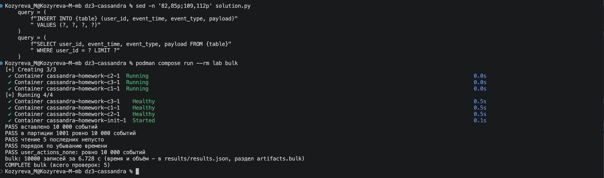

**5. Разделы 5 и 6.** `bash ops.sh tablestats`: размер, число файлов, сжатие и блум фильтр для обеих таблиц.

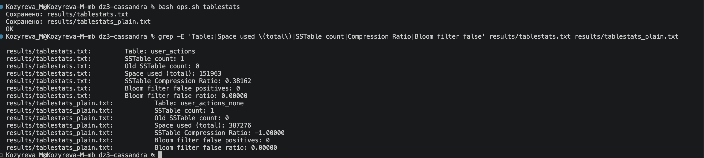

**6. Раздел 8, компакция.** `bash ops.sh compact` и история компакций

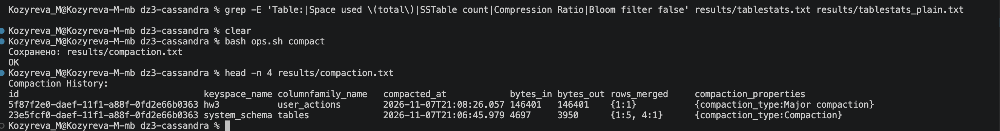

**7. Раздел 4.** Сценарий `consistency`

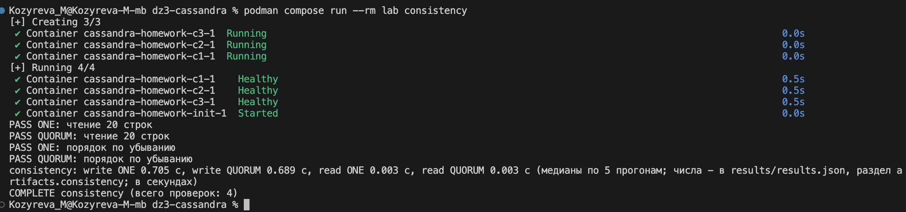

**8. Раздел 7.** `bash ops.sh repair`

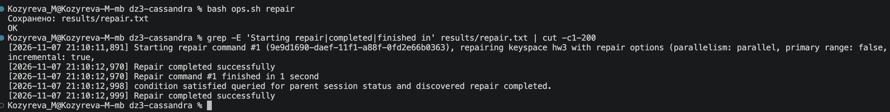

**9. Раздел 9.** Сценарий `metrics`

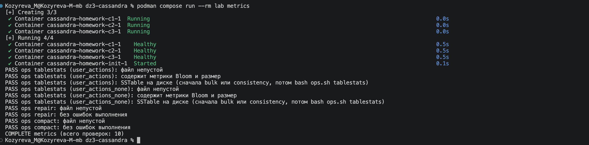

**10. Итоговый `lab all`.** Все сценарии

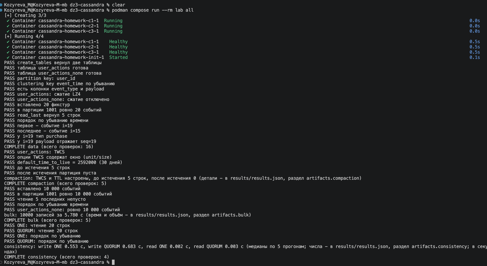

**11. Остановка стенда.** Конец вывода `lab all` и `podman compose down`.

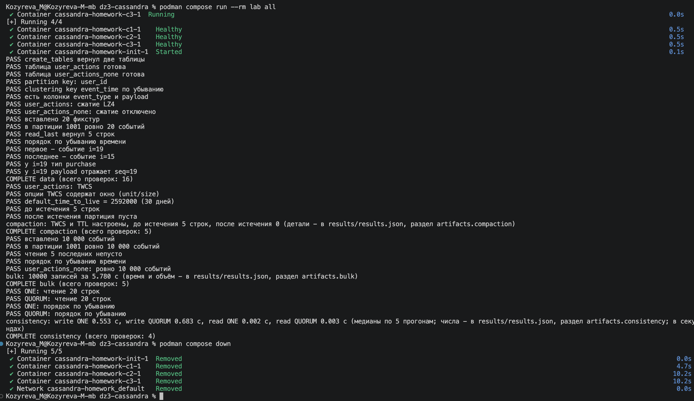
